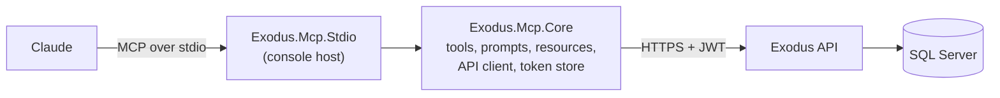

# Exodus MCP

[](https://github.com/oytunemre/exodus-mcp/actions/workflows/ci.yml)

A [Model Context Protocol](https://modelcontextprotocol.io) server, written in C# on .NET 10, that lets Claude shop and sell on [Exodus](https://github.com/oytunemre/Exodus), my ASP.NET Core marketplace API. Run as a **customer**, Claude searches listings, fills a cart and places a cash-on-delivery order, but only after you approve it. Run as a **seller**, Claude manages listings and stock, confirms and ships orders and writes a sales report. It talks to the same REST API as any other client, with a real login and real authorization. It is not a back door.

> **Demo GIF coming soon.** It will live at `docs/demo.gif`.

## Architecture



`Exodus.Mcp.Core` has no dependency on a host or a transport. Phase 2 adds an HTTP host project; the tools, prompts and API client carry over, and only the auth layer changes (see [Roadmap](#roadmap)).

| Project | Role |
|---|---|
| `src/Exodus.Mcp.Core` | MCP tools, prompts, resources, typed Exodus client, auth handler, token store |
| `src/Exodus.Mcp.Stdio` | Console host: configuration validation, stdio transport, logs to stderr |
| `tests/Exodus.Mcp.Tests` | xUnit tests (see [Testing](#testing)) |

## Tools

One server process serves one profile (`EXODUS_PROFILE`) and exposes only that profile's tools. The customer profile has 13 tools and the seller profile has 11. `whoami` is in both.

Annotation key: **R** read-only, **I** idempotent, **D** destructive. Every tool also sets `openWorld=false` explicitly.

### Customer profile

| Tool | Exodus route | Hints |
|---|---|---|
| `whoami` | `GET api/auth/me` | R I |
| `search_listings` | `GET api/listings/search` | R I |
| `get_listing` | `GET api/listings/{id}` + `GET api/product/{id}` | R I |
| `list_categories` | `GET api/category/tree` | R I |
| `get_cart` | `GET api/cart/my` | R I |
| `add_to_cart` | `POST api/cart/add` | none |
| `update_cart_item` | `PUT api/cart/{userId}/item/{itemId}` | I |
| `remove_from_cart` | `DELETE api/cart/{userId}/item/{itemId}` | I |
| `list_my_addresses` | `GET api/address` | R I |
| `place_order` | `POST api/order/checkout` + `POST api/payment/intents` (`CashOnDelivery`) | none |
| `list_my_orders` | `GET api/order` | R I |
| `get_order` | `GET api/order/{id}` or `GET api/order/number/{orderNumber}` | R I |
| `cancel_order` | `POST api/order/{id}/cancel` | D |

### Seller profile

| Tool | Exodus route | Hints |
|---|---|---|
| `whoami` | `GET api/auth/me` | R I |
| `list_my_listings` | `GET api/seller/listings`, `.../low-stock`, `.../out-of-stock` | R I |
| `create_listing` | `POST api/product` (optional) + `POST api/seller/listings` | none |
| `update_listing` | `PUT api/seller/listings/{id}` | I |
| `update_stock` | `PATCH api/seller/listings/{id}/stock` | I |
| `list_seller_orders` | `GET api/seller/orders` | R I |
| `get_seller_order` | `GET api/seller/orders/{id}` + shipment timeline | R I |
| `confirm_order` | `POST api/seller/orders/{id}/confirm` | I |
| `ship_order` | `POST api/seller/orders/{id}/ship` | none |
| `mark_delivered` | `PATCH api/shipments/seller-orders/{id}/deliver` | none |
| `sales_summary` | `GET api/seller/orders` (paged, aggregated in the server) | R I |

### Prompts and resources

| Kind | Name | Profile | What it does |
|---|---|---|---|
| Prompt | `shopping_assistant` | customer | Search, compare, add to cart, confirm address and totals, then wait for explicit approval before `place_order` |
| Prompt | `seller_daily_report` | seller | Low and out-of-stock listings, pending orders and a 7-day sales summary |
| Resource | `exodus://categories` | both | Category tree as JSON (same data as `list_categories`) |

## Setup

**1. Run Exodus.** Follow the [Exodus README](https://github.com/oytunemre/Exodus#getting-started): a SQL Server container plus `dotnet user-secrets` for the connection string. The API listens on `http://localhost:5013` by default. Outside Production it seeds demo accounts, all with the public demo password `Demo123!`: `ahmet@test.com` (customer) and `zeynep@test.com` (seller).

**2. Build.**

```bash
dotnet build Exodus.Mcp.sln
```

**3. Register the server.** Replace `<path>` with your clone.

```bash
# Customer profile
claude mcp add exodus-customer \
  -e EXODUS_PROFILE=customer -e EXODUS_USERNAME=ahmet@test.com -e EXODUS_PASSWORD=Demo123! \
  -- dotnet run --project <path>/src/Exodus.Mcp.Stdio

# Seller profile
claude mcp add exodus-seller \
  -e EXODUS_PROFILE=seller -e EXODUS_USERNAME=zeynep@test.com -e EXODUS_PASSWORD=Demo123! \
  -- dotnet run --project <path>/src/Exodus.Mcp.Stdio
```

**Claude Desktop** (`claude_desktop_config.json`):

```json
{
  "mcpServers": {
    "exodus-customer": {
      "command": "dotnet",
      "args": ["run", "--project", "<path>/src/Exodus.Mcp.Stdio"],
      "env": {
        "EXODUS_PROFILE": "customer",
        "EXODUS_USERNAME": "ahmet@test.com",
        "EXODUS_PASSWORD": "Demo123!"
      }
    },
    "exodus-seller": {
      "command": "dotnet",
      "args": ["run", "--project", "<path>/src/Exodus.Mcp.Stdio"],
      "env": {
        "EXODUS_PROFILE": "seller",
        "EXODUS_USERNAME": "zeynep@test.com",
        "EXODUS_PASSWORD": "Demo123!"
      }
    }
  }
}
```

Startup is faster if you run `dotnet build` once and point the command at the built DLL instead of `dotnet run`: use `dotnet <path>/src/Exodus.Mcp.Stdio/bin/Debug/net10.0/Exodus.Mcp.Stdio.dll`.

### Environment variables

| Variable | Required | Default | Meaning |
|---|---|---|---|
| `EXODUS_PROFILE` | yes | none | `customer` or `seller` (case-insensitive) |
| `EXODUS_USERNAME` | yes | none | Exodus email or username |
| `EXODUS_PASSWORD` | yes | none | Exodus password |
| `EXODUS_BASE_URL` | no | `http://localhost:5013` | Exodus API address, `http` or `https`, no credentials, query or fragment in it |

Invalid configuration makes the process print what is wrong to stderr and exit with code 2. The password is never echoed.

## Design decisions

**Two profiles, not one big server.** A customer session that can see `ship_order` or `create_listing` invites mistakes and wastes context. Each process registers only the tools for its role, and server instructions are written per profile. The server also checks that the account's actual role matches `EXODUS_PROFILE` at login.

**No card data, ever.** No tool takes a card number and no output contains one. `place_order` can only create a `CashOnDelivery` payment intent. Taking payment credentials through an LLM context is a risk I chose to design out. The tool description and the `shopping_assistant` prompt tell the model to get explicit approval of cart, address and total before it calls `place_order`.

**Token management.**
- Login is lazy: Exodus is first contacted by the first tool call, not at startup.
- The access token is refreshed about a minute before it expires. The refresh token rotates, so the old one is dropped.
- A `401` triggers exactly one renewal and one retry of the request (body buffered so the retry is identical). A second `401` is returned as is.
- There is no retry loop on login failure. Exodus locks an account after 5 failed attempts and rate-limits auth to 10 requests per minute. So login and refresh run under one lock, and a permanent failure (bad credentials, wrong role, 2FA) is remembered and returned on later calls without another request.
- An account with 2FA enabled is rejected with a clear message, and so is a role that does not match the profile.
- Passwords and tokens are kept out of `ToString()` output, logs and error messages.

**Errors written for the model.** Tool errors are short, actionable messages ("which input is wrong, what to do next") rather than stack traces or raw HTTP bodies. Only `McpException` messages reach the client, so every failure path is translated explicitly. The tool descriptions, prompts and error messages are written in Turkish, the language of the target users.

**stdout belongs to the protocol.** Anything else on stdout corrupts the JSON-RPC stream. All logging, including the host's lifetime messages, goes to stderr, and a test runs the real process to check that stdout carries only MCP messages.

## Security issues found and fixed in Exodus while building this

Building a client that exercises the API end to end showed real problems in Exodus. I fixed them in the API, with tests, before relying on it:

- Any authenticated user could call the payment authorize, capture, refund and simulate-success/fail endpoints, and could act on payment intents of other users' orders; those five are now Admin-only (the simulators also Development-only) and the intent endpoints check order ownership: [`bc6c569`](https://github.com/oytunemre/Exodus/commit/bc6c569). The 3DS confirm simulator is now Admin-only and Development-only too: [`332e913`](https://github.com/oytunemre/Exodus/commit/332e913).
- A seller could act on other sellers' orders and shipments through a legacy controller; ownership is now enforced and that controller is removed: [`fdd9b73`](https://github.com/oytunemre/Exodus/commit/fdd9b73), [`0f85116`](https://github.com/oytunemre/Exodus/commit/0f85116) (shipping and delivery only through the shipment endpoints).
- The anonymous payment webhook never checked a signature, so anyone could post `payment.captured` or `payment.refunded`; it now verifies `X-Webhook-Signature` and returns 401 without changing state: [`22aaf4d`](https://github.com/oytunemre/Exodus/commit/22aaf4d).
- A payment result could regress or revive an order (for example a cancelled one); success and failure now move only a Pending order: [`47c5550`](https://github.com/oytunemre/Exodus/commit/47c5550).
- A customer could cancel an order after shipment, restocking delivered goods, and seller status could move backwards; cancel is now blocked after shipment and status moves forward only: [`e2978b5`](https://github.com/oytunemre/Exodus/commit/e2978b5).
- Any seller could rename or delete a shared catalog product, taking rivals' listings down with it; product edit and delete are now Admin-only: [`7c2cff1`](https://github.com/oytunemre/Exodus/commit/7c2cff1).
- Creating a listing accepted invalid price and stock values and did not return the created listing; it now validates both and returns the listing: [`f702aef`](https://github.com/oytunemre/Exodus/commit/f702aef).

## Testing

```bash
dotnet test Exodus.Mcp.sln
```

The suite covers:
- **Unit tests** for configuration, token store, auth handler (single retry, no login loop, rotation), query strings and tool input checks.
- **In-memory protocol tests**: a real MCP client and server over an in-memory transport against a fake Exodus. They check the exact tool set per profile, the annotation table and parameter descriptions.
- **Real-process stdio tests**: the built host is started as a child process and spoken to over stdin/stdout.
- **Live end-to-end test (opt-in)**: a customer process and a seller process against a running Exodus. Search, cart, order, then the seller confirms and ships and the customer sees the result. It is skipped unless enabled:

```bash
EXODUS_LIVE=1 dotnet test Exodus.Mcp.sln --filter LiveScenarioTests
# another Exodus address: EXODUS_BASE_URL=http://localhost:5013
```

CI (`.github/workflows/ci.yml`) builds with NuGet vulnerability audit warnings (moderate, high, critical) as errors, then runs the tests. Build warnings are errors everywhere (`TreatWarningsAsErrors`).

Inspect the server interactively with the [MCP Inspector](https://github.com/modelcontextprotocol/inspector) (set the `EXODUS_*` variables in its environment panel):

```bash
npx @modelcontextprotocol/inspector dotnet run --project src/Exodus.Mcp.Stdio
```

## Roadmap

**Phase 2: HTTP transport with pass-through JWT.** A new HTTP host project serves MCP over HTTP and forwards the caller's own Exodus JWT instead of logging in with a configured username and password. The tools, prompts and API client carry over. The auth layer (`TokenStore`, `ExodusAuthHandler`, `ExodusOptions` and the DI wiring) is swapped for per-request bearer-token forwarding, because today it assumes one configured account per process.
